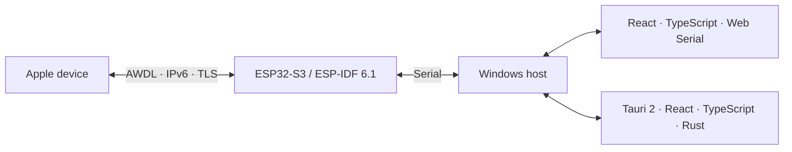

<div align="center">

# AirBridge

**An experimental AirDrop bridge for Windows, powered by ESP32-S3.**

[English](README.md) · [繁體中文](README.zh-Hant.md) · [Español](README.es.md)

[](LICENSE)  

</div>

AirBridge puts Wi-Fi and Bluetooth on an ESP32-S3 and connects it to Windows over serial. A portable C++17 core implements AWDL framing, synchronization and protocol parsing; ESP-IDF 6.1 provides the radio backend. One React/TypeScript interface supports a direct Web Serial browser backend and the retained Tauri 2/Rust desktop backend.

## Project status

macOS Finder discovered **AirBridge PC** and delivered a 262,145-byte binary with matching source and destination SHA256. Both 6 Mbps and the directed-presence/1 Mbps comparison passed scoped native receive tests. The independent sender also delivered a 65,537-byte binary to the Mac and received it back on the same firmware, with all three actual file SHA256 values matching.

| Capability | Status |
| :--- | :--- |
| AWDL parsing, clocks and topology | Implemented |
| Apple peer admission | Hardware verified |
| IPv6 over AWDL | Hardware verified |
| Native device names | Verified through TLS `/Discover` |
| Mac → Windows files | Text and 262,145-byte binary verified |
| Windows → Mac files | 65,537-byte binary and same-image roundtrip verified |
| Rust transfer backend | Native 4,097-byte binary roundtrip verified without Python |
| Web Serial application | Implemented; browser storage/UI and virtual-wire tests passed; real serial/native AirDrop acceptance pending |
| Desktop application | Development build; real connection and native names verified; desktop file qualification in progress |

<details>
<summary>Verified binary fingerprint</summary>

`AirBridge-native-receive-262145.bin` · 262,145 bytes

```text
eb3ddcc7caeb6bef3d10eacdfc07ce0a89997ae4741711c528cce1402d65596c
```

</details>

> Development status: long-term visibility, repeated reconnects, larger transfers, iPhone interoperability, contact-only authentication and folder transfer remain unqualified. A discovered MAC or a successful TX callback does not prove file delivery.

## Web application

Use desktop Chrome or Edge without installing the Tauri application. The same
React interface connects directly to the bridge, resolves native Apple names,
selects recipients and files, shows duplex progress and checks received files
after closing and reopening them. The static host does not carry file payloads.

```powershell
cd desktop
npm ci
npm run dev
```

Open **http://127.0.0.1:1420/**, choose a receive folder, then connect the verified
COM4 in the browser chooser. Browser-capable firmware with `hardware_id` support
is required. This is a development build; earlier CLI native transfer evidence
does not qualify the new browser path.

[Web setup and checked-storage design](desktop/README.web.md) · [Measured web status](docs/web-qualification.md) · [Interface details and information sources](docs/product-details.md)

## Desktop application

The desktop includes device selection, native file and folder dialogs, outgoing and incoming progress, cancellation, checked receive locations and transfer details. English is the default; Traditional Chinese and Spanish are available in Settings. Names come from native `/Discover`, with an explicit fallback when unresolved.

[Desktop build and usage](desktop/README.md) · [Measured desktop status](docs/desktop-qualification.md)

## Hardware & prerequisites

| Item | Details |
| :--- | :--- |
| Development target | ESP32-S3 · 16 MiB flash · 8 MiB octal PSRAM |
| Firmware SDK | ESP-IDF 6.1 |
| Windows link | Native USB Serial/JTAG; external USB–UART is a separate, unqualified transport |
| Apple acceptance target | A Mac with Wi-Fi and Bluetooth enabled; AirDrop set to Everyone |
| Host tools | Python with pyserial; Visual Studio C++ tools or CMake for protocol checks |

The receiver uses PSRAM for bounded archive buffers. Earlier scanner-only revisions do not require those receive buffers.

## Quick start

### 1. Prepare the board and SDK

Activate an ESP-IDF 6.1 environment, connect the intended board and inspect its serial identity. Use one process to own the port.

```powershell
python -m pip install -r scripts/requirements.txt
python -m serial.tools.list_ports -v
```

The current host CLI validates one development board on **COM4**, including its USB serial. Review the binding in `scripts/receive-native.py` before adapting it to another board.

### 2. Build the firmware

Replace the example MAC with a fresh, advertised Apple AWDL peer from the scanner. The native receiver currently permits that explicitly configured peer.

```powershell
$peer = 'aa:bb:cc:dd:ee:ff'
idf.py -C firmware -B work/native `
  -D AIRBRIDGE_PRESENCE_TX=ON `
  -D AIRBRIDGE_IPV6_LINK=ON `
  -D AIRBRIDGE_NATIVE_SERVICE=ON `
  -D AIRBRIDGE_RAW_RATE_1M=ON `
  -D "AIRBRIDGE_PROBE_PEER=$peer" build
```

The command selects the 1 Mbps comparison rate. Full RF calibration was also used in its recorded acceptance run; calibration alone has not been established as a discovery fix. The local `scripts/build-firmware.ps1` helper supports `-FullCalibration -LegacyRate1M`, but assumes the SDK layout documented in that script.

### 3. Flash the verified board

Flashing replaces the active application. Preserve a working image and confirm the board identity first. The project reserves a 2 MiB application at `0x10000`, NVS at `0x9000` and PHY data at `0xf000`; keep that layout when comparing firmware.

```powershell
idf.py -C firmware -B work/native -p COM4 flash
```

### 4. Start the Windows receiver

```powershell
python scripts/receive-native.py --directory received/inbox --log work/receive.jsonl --seconds 0
```

Keep the CLI running. Unlock the Mac, enable Everyone in AirDrop, then share a file from Finder to **AirBridge PC**. Compare the source SHA256 with the receipt and the actual Windows file. Close any old Waiting dialog before retrying.

Each serial chunk must be acknowledged. Windows checks sizes and SHA256, flushes files and publishes the temporary directory before confirming the transfer. Receipts sit beside completed directories; failed `.partial` output is retained for diagnosis.

### 5. Send from Windows

Stop any separate receiver process first. The sender owns the same serial port
and services incoming records while waiting for native Apple consent.

```powershell
python scripts/send-native.py C:\path\to\file.bin --peer $peer `
  --directory received/inbox --log work/duplex.jsonl --listen-after
```

Accept the native AirDrop prompt on the Mac. The CLI separates source staging,
consent, archive transmission and native HTTP completion. It reports the native
peer name from `/Discover`. Initial sending is bounded to one file up to 1 MiB;
actual destination SHA256 is a separate acceptance check. A failed or uncertain
operation is never automatically resent.

## Verification

**Portable protocol assertions: 346.** **Windows host tests: 20.**

The portable suite covers malformed frames, bounds, synchronization and protocol wire data. Host tests exercise offset, digest and durable-publication failures. Hardware evidence is recorded separately.

```powershell
cmd /c scripts\test-native.cmd
```

```powershell
cmake -S . -B build
cmake --build build --config Release
ctest --test-dir build -C Release --output-on-failure
```

```powershell
python -m unittest discover -s tests -p "test_*.py" -q
```

## Architecture



AWDL carries IPv6; mDNS locates the AirDrop service, and TLS carries discovery and transfer requests. Bluetooth provides a nonconnectable wake advertisement. The Windows Wi-Fi adapter does not need AWDL injection support.

AWDL MAC, DNS service instance, host label and AirDrop display name are different identities. Friendly names come from the native `/Discover` response when the peer provides one.

## Repository layout

| Item | Details |
| :--- | :--- |
| `core/` | Portable C++17 protocol core |
| `firmware/` | ESP-IDF radio backend |
| `scripts/` | Host and development tools |
| `tests/` | Protocol and host verification |
| `docs/` | Measured acceptance and reference notes |

## Documentation & evidence

- [Native duplex acceptance](docs/native-duplex.md)
- [Serial control protocol](docs/serial-protocol.md)
- [Product acceptance gates](docs/product-acceptance.md)
- [Protocol references](docs/protocol-references.md)
- [AWDL neighbor admission](docs/awdl-qualification.md)
- [IPv6 payload roundtrip](docs/ipv6-qualification.md)
- [Native names through Discover](docs/discover-qualification.md)
- [Streaming archive core](docs/transfer-core.md)
- [Native receiving and file hashes](docs/native-receiving.md)
- [Discovery stability comparisons](docs/discovery-stability.md)
- [Machine-readable receive receipt](docs/native-receive-2026-10-16.json)

## Roadmap

- [x] Independent Windows → Apple sending and a verified same-image binary roundtrip
- [ ] Stable discovery, reconnect recovery and clearer failure states
- [ ] Broader peer selection, real names and transfer progress
- [x] Tauri 2 desktop development build with React, TypeScript and Rust
- [x] Shared React browser interface and direct Web Serial transfer backend
- [ ] Browser real-serial duplex and user-selected-directory acceptance
- [ ] Packaged desktop native duplex and sustained discovery qualification
- [ ] Expanded device, file-size and transport qualification

## Acknowledgments

The principal Linux reference is [t4t5/omdrop-owl](https://github.com/t4t5/omdrop-owl). Its fixed-channel strategy, synchronization selection and receive-padding work inform the interoperability requirements. Thanks also to [OWL](https://github.com/seemoo-lab/owl) and [OpenDrop](https://github.com/seemoo-lab/opendrop) for their AWDL and AirDrop research. Reference use and pinned revisions are documented in [protocol references](docs/protocol-references.md); this tree contains no vendored protocol source from these projects.

## License

[MIT](LICENSE). AirDrop is Apple’s technology. AirBridge is an independent experimental project, with no Apple affiliation or endorsement.
