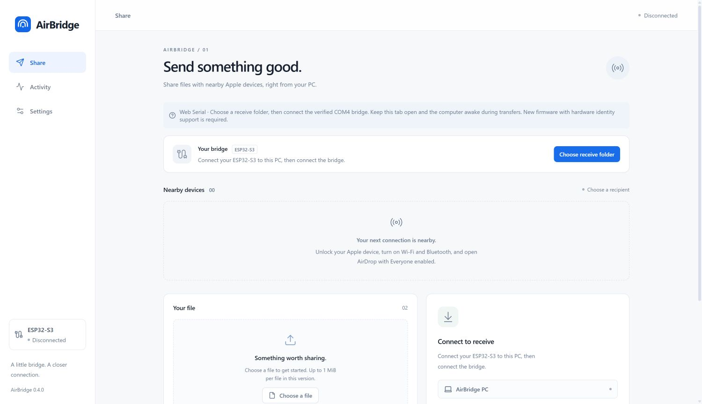

# AirBridge Web

Open the hosted **[HTTPS application](https://w0x7ce.eu/AirBridge/)** in desktop
Chrome or Edge. See [deployment and permissions](../docs/pages.md). Tauri remains
available in this same project. The production UI now has ambient motion by
default before connecting; reduced-motion and remembered manual pause are respected.
Device arrivals, reversible departures, selection and transfer progress use a
[shared motion system](../docs/discovery-motion.md), without changing the native
confirmation or checked-file publication rules.

Settings now offers English (default), Spanish, French, Traditional Chinese and
Arabic, with Light, Dark or System appearance. Arabic uses a full RTL layout.
[Language, appearance and automated matrix coverage](../docs/localization-and-appearance.md).



*Actual Chrome capture with no hardware connected; no simulated peers or transfers.*

The existing React application now has two backends in the **same project**.
Opening it in desktop Chrome or Edge selects Web Serial. Launching it inside
Tauri retains the existing Rust backend. Tauri, its CLI and its source remain
available; the browser route does not launch them or a Python transfer process.

```text
React + TypeScript ↔ Web Serial ↔ ESP32-S3 ↔ AWDL / IPv6 / TLS ↔ Apple AirDrop
```

Files travel over the local serial and radio links. A static web server only
serves the application assets; it does not receive file payloads. There are no
analytics, accounts, CDN runtime dependencies or cloud transfer endpoints.

## Public app and demo

The [hosted app](https://w0x7ce.eu/AirBridge/) works without an account or desktop
installation. [Explore the demo](https://w0x7ce.eu/AirBridge/?demo=1) without a
board: sample names and transfers are clearly simulated, with no serial, radio,
file-picker or disk access. Leaving the demo starts the real app disconnected.
The demo does not prove hardware compatibility or file delivery.

## Start locally

Install Node.js 22 or newer. From the repository:

```powershell
cd desktop
npm ci
npm run dev
```

Open **http://127.0.0.1:1420/** in desktop Chrome or Edge for development. Use the
production preview for live transfers so source edits cannot hot-reload a serial
session. Stop the development server first, then:

```powershell
npm run build
npm run preview
```

Only `dist/` is needed on a static HTTPS host. Relative assets support subdirectory
hosting. Opening `index.html` directly from Explorer is not the supported startup
path. The local server binds loopback by default; no LAN exposure is required.
Safari, mobile browsers and browsers missing either Web Serial or the directory
picker receive an explicit unsupported message. The interface remains navigable.

## Connect and use

For incoming files, select a freshly observed Apple device and click **Allow
selected device** before using its native AirDrop panel to send to **AirBridge PC**.
Revoke authorization after use. One incoming peer is permitted per public serial
session; a reconnect clears it. This is an address allowlist, not Apple-account
or Contacts Only authentication. The new public firmware profile and browser-native
AirDrop path still require physical qualification; see [release notes](../docs/release-notes-v0.0.1.md).


1. Close Tauri, serial monitors, Python receivers and flash tools that own the port.
2. Connect your ESP32-S3 N16R8 through native USB Serial/JTAG. Download and
   verify the [public firmware](../docs/firmware-release.md). Public builds accept
   your explicitly selected compatible board; there is no fixed COM-number or
   developer serial-number requirement.
3. Use browser-capable firmware with the additive `hardware_id` reply field.
   Older firmware is rejected safely; it is not silently trusted. See
   [serial protocol](../docs/serial-protocol.md). The firmware remains ESP-IDF 6.1.
4. Click **Choose receive folder** at the top (or **Choose folder** in Receive
   or Settings) and grant read/write access to
   an appropriate receive directory. The folder is selected for this page session;
   no implicit Downloads write or persisted permission is assumed.
5. Click **Connect bridge**, then select the verified bridge in the browser chooser.
   Web Serial does not expose COM numbers; correlate COM4 in Device Manager.
   The filter selects Espressif USB Serial/JTAG (`303a:1001`); HELLO must then
   identify factory MAC `f0:9e:9e:1e:61:3c`. Only after this check are incoming
   records accepted or transfer commands enabled. DTR/RTS are explicitly false.
6. Unlock the Mac, enable Wi-Fi/Bluetooth and AirDrop Everyone. Select an advertised
   device card. When supported, selection issues a read-only native `/Discover`
   name query. Actual Apple names are shown; DNS host labels are never substituted.
7. Choose one file, then **Send**. Accept the native Mac invitation. Sending is
   bounded to **1 MiB**. Staging and archive progress are distinct; 100% wire
   progress means finishing. Native success must also match the staged size/hash.
8. To receive, share from native Apple AirDrop to **AirBridge PC**. Keep this tab
   open and the computer awake. Each received transfer gets its own new directory.
9. Check Activity and the saved `airbridge-receipt.json`. Completed transfer details
   offer **Save receipt**. Browser pages cannot open Explorer; use the folder you
   selected and the directory shown in transfer details.
10. Disconnect before another serial owner, firmware flash, or receive-folder change.

English is the default. Settings also offers Traditional Chinese and Spanish.
No hardware access is initiated on page load, and USB connection does not
automatically issue a name query. A newly selected port always goes through the
browser chooser; this build does not open every previously granted port.

## Device and transfer details

Open the **ⓘ** beside a device for its name source, temporary AWDL address,
reported signal and protocol observations. Use **Bridge details** for validated
handshake values. Missing readings are marked **Not reported**, and RSSI is not
interpreted as physical distance.

Activity supports direction/active filters, file/device search and metadata-only
JSON export. Completed multi-file receipts retain each checked file and hash.
Dialogs support keyboard navigation, Escape and focus restoration. See
[product details and information provenance](../docs/product-details.md) for
field sources, status semantics and the validation boundary.

## Checked receiving

One serial reader handles both command replies and incoming records while a single
writer serializes all complete commands and ACKs. Native sending does not stop the
incoming ACK path. Session nonces, CRC32, reply sequences and exact chunk offsets
follow protocol v2. A timeout never automatically repeats a file send.

Receiving validates the offered manifest, safe Windows-compatible names, case-folded
duplicates, file indexes, sizes, metadata bounds and exact offsets. Incoming bytes
are written in acknowledged chunks of at most 512 bytes. Each file is closed,
reopened from the selected file system and its actual bytes are hashed with SHA256.
The whole transfer must pass before the checked receipt is closed and `COMMIT`
is sent. Completion additionally requires `host_committed` and `response_written`.

The receipt has explicit states:

| Saved receipt | Meaning |
| --- | --- |
| `receiving` | Partial/incomplete data; no completion claim |
| `files_verified` | Files closed and readback hashes checked; native response pending |
| `completed` | Native completion confirmed and final receipt saved |

The browser file API has no portable atomic directory rename or OS-level `fsync`.
This implementation uses a fresh random transfer directory and the receipt as
the logical publication boundary. It does **not** claim power-loss durability
equivalent to the Rust receiver. A file-system failure withholds commit; a failure
after commit remains uncertain and is never automatically resent. Incomplete
directories remain for inspection rather than being deleted or overwritten.

Current receive policy: at most 16 regular files and 64 MiB total; each AppleDouble
metadata sidecar is bounded to 128 KiB. `airbridge-receipt.json` is reserved. Hashing
uses one bounded file buffer at a time. One outgoing regular file is staged in PSRAM.
The development firmware still restricts incoming access to its configured peer.
This interface does not add contacts-only authentication or local incoming consent.

## Verification

Disconnect/reconnect, cancellation, receive failure and saved-file checks are
covered by [failure recovery and automated acceptance](../docs/failure-recovery.md).
With the development server running, `/tests/failures.html` runs six application
flows automatically using the production React view/command dispatcher, virtual
serial and real browser OPFS. It never opens hardware or a real USB chooser.
The production bundle excludes the fixture. History entries remain separate even
when firmware reuses a wire transfer ID after restart.


```powershell
npm test
npm run build
```

The wire tests use virtual serial streams and actual temporary host files. They
cover CRC, fragmented records, independent Python plist decoding, identity rejection,
concurrent ACKs, close/readback/hash failures, stale peers, native completion and
no automatic resend. Install Python 3 with its standard library to run the
independent plist test; `AIRBRIDGE_TEST_PYTHON` can select its executable.

With the development server running, open
**http://127.0.0.1:1420/tests/storage.html** and click **Run browser storage checks**.
This development-only harness uses the real browser origin-private file system
for zero-byte, Unicode and 262,145-byte binary samples. It never opens serial;
its completion record is synthetic and must not be reported as native AirDrop.
The harness is not included in the production `dist/` bundle.

See [web qualification](../docs/web-qualification.md) for measured results and
the still-pending real COM4, user-selected directory and native AirDrop gates.

## Discovery design and interaction

The shared interface uses circular device avatars, a quiet discovery field,
selection halos and smooth arrivals/departures. Lost peers become noninteractive
immediately; their visual exit cannot make them valid recipients. Reduced-motion
preferences are respected. A labeled, development-only interaction preview is
available at `/tests/motion.html`; it uses synthetic devices and opens no serial
port. See [discovery presentation](../docs/discovery-motion.md) for the state
contract, preview capture and measured UI checks.

## 繁體中文快速操作

以桌面 Chrome／Edge 開啟本機頁面，先選擇接收資料夾，再在瀏覽器選擇器中
連接已核對的 COM4。需要帶有 `hardware_id` 的新韌體；舊韌體會被拒絕。
選取附近裝置後查詢原生名稱，選擇檔案並傳送；接收時在 Apple AirDrop 選擇
**AirBridge PC**。保持分頁開啟及電腦喚醒。每次接收會建立獨立資料夾，
只有 `airbridge-receipt.json` 為 `completed` 才代表原生接收完成。
目前瀏覽器與儲存測試不等於真實串口或 AirDrop 驗收。

## Inicio rápido en español

Abre la página local en Chrome o Edge de escritorio. Elige primero una carpeta
de recepción y después el COM4 verificado en el selector del navegador. Se requiere
firmware con `hardware_id`; el antiguo se rechaza. Selecciona un dispositivo para
consultar su nombre nativo, elige un archivo y envíalo. Para recibir, selecciona
**AirBridge PC** en AirDrop de Apple. Mantén la pestaña abierta y el equipo despierto.
Cada recepción crea un directorio independiente; solo el estado `completed` del
comprobante confirma la recepción nativa. Las pruebas de navegador y almacenamiento
no equivalen a una validación real del puerto serie o de AirDrop.
