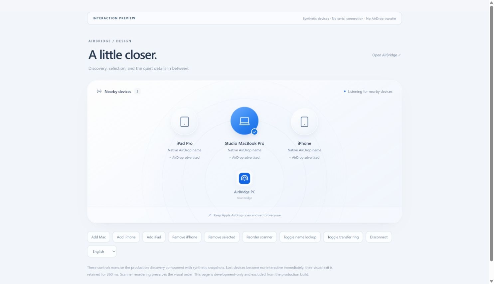
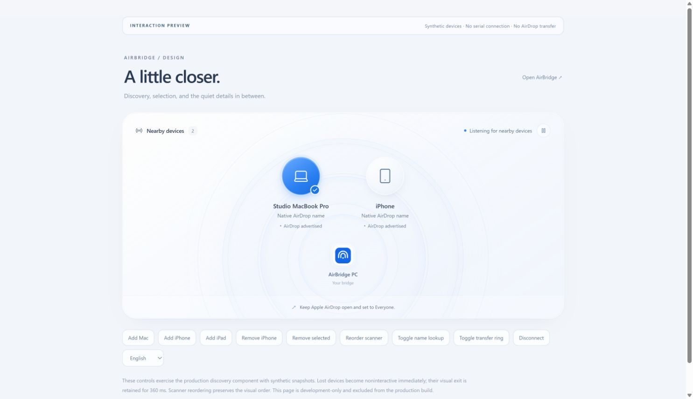

# Discovery presentation

AirBridge's shared React interface uses a restrained discovery surface: soft
concentric rings, circular device glyphs, a blue selection halo, and a small
bridge identity at the center of the space. The browser and Tauri share the same
component. No radio, serial, TLS or file-publication code changed in this update.

## State and motion

| Change | Presentation | Eligibility |
| --- | --- | --- |
| New advertisement | 520 ms opacity/scale arrival | Comes from the live snapshot |
| Recipient selected | 240 ms blue crossfade, halo and checkmark | Explicit selection only |
| Name lookup | Fine orbit around the device | Only while the resolver reports active |
| Active outgoing transfer | 440 ms ring/bar interpolation from source/wire progress | Completion still comes from the existing backend |
| Advertisement lost | 360 ms visual departure | Immediately disabled and hidden from accessibility navigation |
| Remaining devices reflow | 420 ms transform interpolation | Does not reorder existing identities to match scanner ordering |
| USB disconnected | Retires visible peers, then shows the idle surface | No discovery or reachability claim |
| Reduced motion | Immediate departure; no entrance, breathing or layout animation | Same live eligibility rules |

The presentation model retains only the visual shell of a lost peer. It sets
`advertised=false`; rendering also checks the current live-MAC set immediately,
before React's effect updates the presentation list. The application's actual
recipient lookup remains based on the live snapshot. No stale visual entry can
enable sending or a name query. A repeated empty scan does not extend the exit
deadline, and the same MAC returning during the exit cancels departure without
duplicating a card. Exit time uses the browser's monotonic clock.

CSS starting styles and reversible transitions handle opacity/transform entrance
and exit. A returning device continues from its current presentation instead of
restarting at zero opacity. The Web Animations API smooths layout changes using
unanimated target offsets; an interrupted move adds its displayed translation
before retargeting. Device identity remains keyed by AWDL MAC; names
are labels, not identity keys. Unknown device types use a neutral glyph.

## Interaction preview

Start `npm run dev` in `desktop`, then open
**http://127.0.0.1:1420/tests/motion.html**.

This explicitly labeled development page supplies **synthetic devices** to the
production discovery component. It can add/remove devices, reorder scanner
snapshots, change selection with the keyboard, show lookup/transfer rings and
switch languages. It never opens serial and is excluded from the production
entry point. The main application has no demo devices or demo-mode switch.

*Browser capture of the labeled synthetic interaction page. This is visual and
interaction evidence, not nearby-device discovery or AirDrop transfer evidence.*

## Propagating signal waves

The production idle screen has three offset blue/lilac/cyan light fields with
10/14/16-second drift cycles and clearer 9-second breathing concentric layers,
without claiming radio activity. Its pause button
is available before connection. See the [hosted product](pages.md); the motion
is no longer limited to a connected bridge or a development preview.

The current surface adds four staggered expanding waves, centered on the bridge
glyph, with a 6.4-second base cycle while connected and a 4/3 playback rate during
an active transfer (equivalent to 4.8 seconds). Updating playback rate preserves
the displayed phase; CSS durations and stagger delays do not restart. These are
**state illustrations**, not RSSI measurements, packet counts,
distance estimates or evidence of delivery. Disconnection removes them entirely.
No JavaScript frame loop or synthetic RF events drive this decoration.

The header pause/resume button supports pointer and keyboard input, with English,
Traditional Chinese and Spanish labels. Pausing affects the decorative signal
waves without interrupting discovery or files. An explicit pause is remembered
across navigation and reload; unavailable preference storage does not block the
interface. Hidden tabs pause the waves;
system reduced motion removes them and disables the animation control. Static
status text and actual progress remain available in every mode.

*Actual browser capture of the labeled synthetic interaction page. The live page
animates; this still image does not demonstrate radio activity.*

Playwright now verifies changing computed transforms, pause/resume stability,
transfer tempo, disconnect retirement, runtime reduced-motion changes, keyboard
activation, translated controls, immediate departure ineligibility and a 390px
layout. These tests run in [GitHub Actions](continuous-delivery.md) together with
browser failure/storage acceptance. The current local run passed 93 unit checks
and all 20 browser tests (one test includes six failure scenarios). New cases
also check reversed departure, selection/deselection, actual SVG interpolation,
unknown-progress wrapper rotation, persisted pause and phase-preserving tempo.
At 100% wire progress, the preview stays in `finishing` until an explicit synthetic
confirmation is injected; no animation fabricates a native success. Background pause
is checked by injected visibility events; this does not qualify OS suspension.
No hardware was used.

Shared timings and the easing curve live in `desktop/src/motion.ts`, with CSS
variables inherited by discovery, controls, transfer rows and details. SVG
progress uses a stable track and interpolated dash offset; indeterminate motion
rotates its wrapper. Preference changes remove both CSS and layout interpolation.
All production storage, identity, native completion and release gates are retained.

## Earlier verification — 2026-10-19

- 27 frontend tests passed: the existing 23 cases plus four presence-model cases.
- Production TypeScript/Vite build passed without new dependencies.
- Chrome walkthrough verified addition, selection, scanner-order stability,
  disappearance/reappearance, keyboard activation, progress presentation,
  disconnection and English/Traditional Chinese/Spanish labels.
- The main disconnected application remained free of synthetic peers.
- Browser console checks are recorded separately from hardware qualification.
- Reduced-motion behavior is implemented in the media query, presentation model
  and layout-animation cancellation. The model's immediate-removal case passed;
  no operating-system preference was changed during verification.

Real COM4 and native AirDrop web acceptance remain pending as described in
[web qualification](web-qualification.md). Visual motion is not a file-delivery
signal, and neither the mock progress ring nor this preview qualifies hardware.
