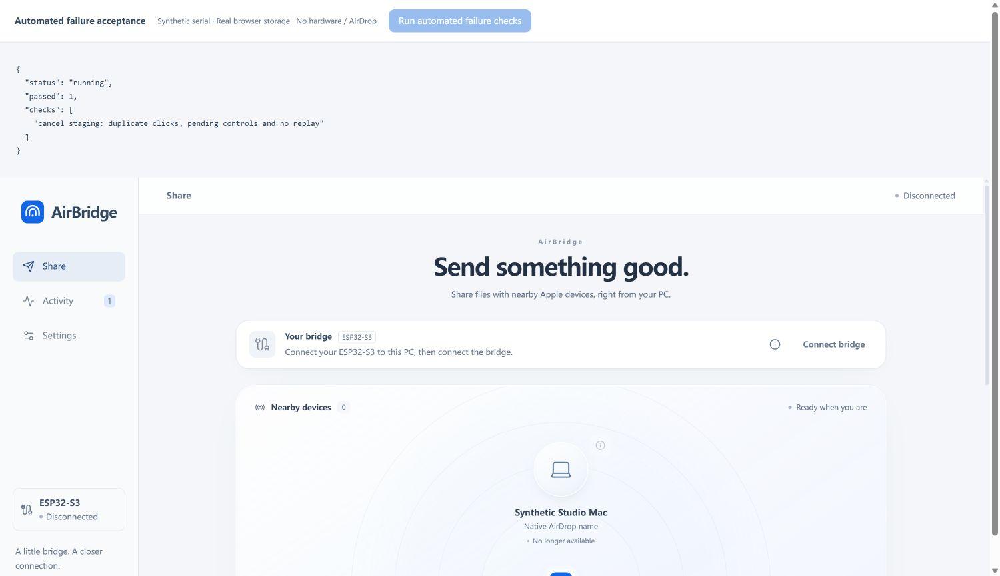

# Failure recovery and automated acceptance

This qualification exercises the browser and Rust host failure paths without
opening a physical serial port. It complements, rather than replaces, native
AirDrop and user-selected Windows folder acceptance.

## Connection ownership

| State | Behavior |
| --- | --- |
| Connecting | One chooser/open/handshake attempt; duplicate opens are rejected |
| Connected | Only the validated session can publish observations or run commands |
| Disconnecting | Peers are retired immediately; active unconfirmed transfers become uncertain |
| Releasing connection | Fault recovery stops the reader/writer and pending operations |
| Port release unconfirmed | Reconnect and receive-folder changes remain blocked; **Retry disconnect** retries cleanup |
| Disconnected / error after cleanup | A new explicit connection performs another identity check and fresh handshake |

A browser cleanup attempt has a five-second reporting deadline. A timeout does
**not** claim that the browser or OS released the device. The session stays
quarantined until cleanup succeeds. An unresponsive browser/driver may require
closing the owning tab or physically reconnecting later; software cannot promise
to interrupt an underlying OS operation. No second owner is started to bypass it.

Disconnecting while the chooser or port open is pending invalidates that attempt.
Its late result cannot start a serial reader or overwrite a newer session.
Disconnecting also releases pending source-preparation waits. A late source read
cannot stage or send a file after cancellation.

## Transfer outcomes

- Cancellation is a request. Its ACK alone does not prove cancellation. Progress
  and stage events keep the UI in **Cancelling** until the native result arrives.
  Valid completed delivery wins a cancellation race; link loss without a definitive
  result stays **Result uncertain**. Duplicate cancel requests share one command.
- Rejected staging is cleaned up once. Timeouts, lost links, rejected commands
  and uncertain outcomes never automatically replay the file.
- A failed receive is terminal for that job. Later chunks, commit challenges or
  completion records cannot repair it into a successful transfer.
- A sixty-second incoming-progress deadline is independent of scanner traffic.
  Browser storage stalls are covered by the same watchdog. Rust checks its receive
  deadline during serial polling; synchronous OS disk calls cannot be preempted.
- Both backends check actual saved bytes after file close, before commit/publication
  and before final completion publication. Saved receipt contents are also read back.
  Corruption, truncation, missing files, close/read failures and receipt failures
  withhold the relevant success boundary.
- If files are checked but native completion or the final receipt is unconfirmed,
  the UI remains uncertain. Existing partial/checked data is retained for inspection;
  it is never advertised as a successful receive or offered as a success receipt.
- Each received history entry has its own host ID. `native_id` retains the wire
  transfer ID for diagnostics. Reusing a wire ID after a firmware restart cannot
  overwrite another entry's directory, receipt or React identity. Activity search
  accepts both IDs, and transfer details display the protocol ID.
- Only validated receiver output can publish host-level receive success. Serial
  records claiming to be host `received` or `incoming_started` notifications are
  ignored. This does not add Apple contacts authentication.

## Measured results — 2026-10-19

| Layer | Result | Evidence boundary |
| --- | --- | --- |
| Frontend/backend unit tests | **83 passed** | Virtual Web Streams, injected failures and real temporary host files |
| Rust workspace | **19 passed** | Actual temporary files and deterministic model/deadline tests |
| Portable protocol core | **346 checks passed** | Local C++ protocol tests |
| Python compatibility tests | **20 passed** | Local regression tests |
| Automated Chrome application flows | **6 passed** | Production React view/dispatcher, virtual serial, real browser OPFS |
| Browser storage | **0 / 4,097 / 262,145 bytes passed** | Closed/reopened actual OPFS files; independent SHA256 checks |
| TypeScript/Vite production build | **Passed** | Test fixtures are excluded from production assets |

The unit matrix includes read EOF/errors, serial write errors, wrong USB/factory
identity, concurrent opens, disconnect during open/selection, close failure,
cleanup timeout/retry, command deadlines with queued work, boot/framing faults,
cancel/completion races, source-read cancellation, rejected staging, receive idle
timeouts despite scanner traffic, file/receipt create/write/close/read failures,
persisted corruption, changes at publication boundaries, repeated native IDs,
duplex history preservation and **30 consecutive reconnect cycles**.

The six browser flows assert actual DOM behavior: disabled/pending controls,
cancel progress, disconnect confirmation, stale-device ineligibility, cleanup
retry, identity-error feedback, hash rejection, unavailable success receipts,
uncertain final-receipt failure and completion only after checked storage plus
the synthetic native completion record. They never access a real USB chooser.

Raw measured results: [frontend checks](evidence/frontend-failures-20261019.json),
[browser failure flows](evidence/browser-failures-20261019.json),
[browser storage hashes](evidence/browser-storage-20261019.json).



*Actual Chrome result page. Serial/native records are synthetic; storage is real
OPFS. This is not physical serial or AirDrop interoperability evidence.*

## Reproduce

[GitHub Actions quality and release gates](continuous-delivery.md) run these
checks on every push/PR, including headless Chromium failure flows and real OPFS
readback. Install Python dependencies from `scripts/requirements-test.txt` first.

```powershell
cd desktop
npm ci
npm test
npm run build
cargo test --workspace --locked
npm run dev
```

In desktop Chrome or Edge open `/tests/failures.html`, then click **Run automated
failure checks**. The suite supplies a virtual port and source picker only within
that page, restores them after each case, and unmounts its fixture. Test files stay
inside uniquely named origin-private directories. It does not ask for Windows
folder access or persist serial permissions. `/tests/storage.html` provides the
larger binary storage check. Both pages are development-only.

From the repository root, `scripts\test-native.cmd` and
`python -m unittest discover -s tests -p "test_*.py" -q` run the other regressions.

No board was connected or flashed in this iteration. Actual USB driver behavior,
browser suspension, physical power faults, the chosen Windows directory and
native Apple duplex delivery still require the separate
[hardware acceptance gates](web-qualification.md).
