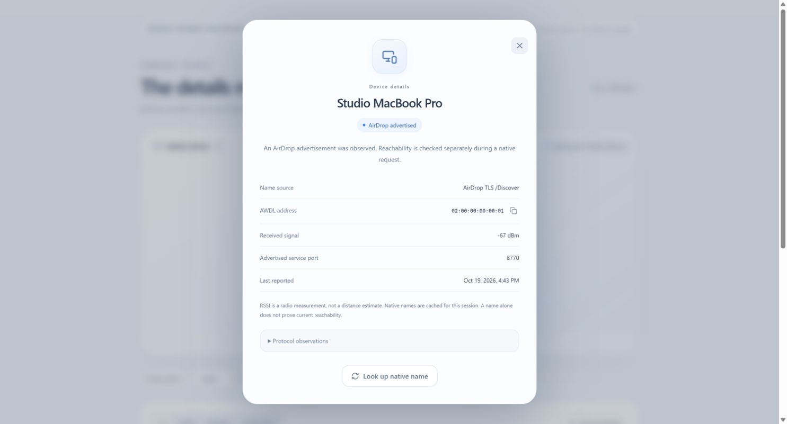
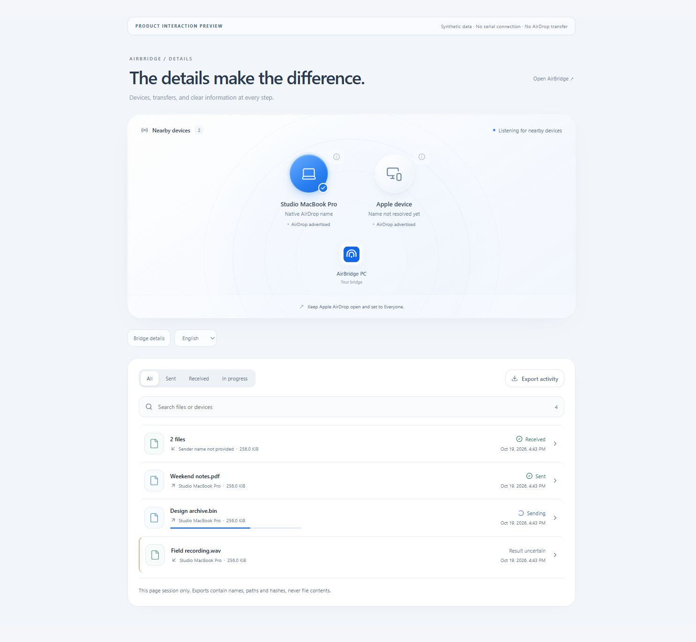

# Product details and information provenance

The Web Serial application and Tauri desktop application share the same React
surfaces. The interface uses quiet blue accents, consistent rounded controls,
restrained motion and explicit status text. English is the default; Traditional
Chinese and Spanish include every new field and action.

## Devices

Select a circular device card to choose a recipient. The separate **ⓘ** button
opens its inspector without changing the selection or opening another serial
connection. A supported name query uses the existing native `/Discover` path.
The inspector remains readable if a device departs, but its query action becomes
unavailable. Radio addresses, rather than friendly names, remain identity keys.

| Field | Actual source | Interpretation |
| --- | --- | --- |
| Native name | Successful native AirDrop `/Discover` response | Cached for this session; retained with outgoing history |
| AWDL address | Firmware scanner observation | Temporary identity, not a permanent hardware identifier |
| Received signal | Firmware-reported RSSI, in dBm | Missing/invalid values show **Not reported**; never converted to distance |
| Advertised port | AirDrop DNS-SD service observation | A valid announcement does not prove a current TLS connection |
| Last reported | Host time when a scanner report was received | Not an exact over-the-air packet timestamp |
| DNS label / service instance | Scanner's parsed discovery records | Protocol identifiers, never substituted for a native friendly name |
| Channel 6 mask / root metric | Parsed AWDL announcement fields | Raw protocol observations, including meaningful zero values |
| Sync / election fields | Scanner observation flags | Missing, false and true remain distinct |

The device glyph is a presentation hint inferred from the native name. It is not
a verified Apple model. Battery level, OS version, physical distance, Apple ID
and a permanent Apple hardware serial are not supplied by this protocol path.

*Actual browser capture with a synthetic device; visual evidence only.*

## Bridge details

The bridge inspector shows negotiated serial protocol, send bound, command chunk
size, factory identity, configured incoming peer, AWDL address and connection
time. Values come from the validated serial handshake. On disconnect, any retained
values are explicitly described as details of the last connection.

Web Serial exposes USB vendor/product IDs but not the USB descriptor serial or
Windows COM-port name. Those unavailable fields are not fabricated from the
firmware factory identity. Tauri can report the descriptor serial verified by
its existing serial-port identity check. Connecting USB alone does not prove
Apple-side discovery, peer presence or file delivery.

## Activity and transfer details

- Filter all, outgoing, incoming or active transfers. Search file names, retained
  native names, AWDL addresses, transfer IDs and individual files in a multi-file
  receipt. Empty results offer a reset action.
- Each row distinguishes direction, file size, state and the last actual transfer
  update. Periodic scanner traffic cannot refresh transfer timestamps.
- Source preparation, native archive progress and incoming file progress have
  separate labels. Unknown totals show indeterminate progress. Reaching 100%
  archive bytes still means **Finishing**, not successful delivery.
- A native sender success is published only after the completion matches the
  staged source size and SHA256. A source hash is explicitly labeled as such;
  hashing the destination on Apple remains a separate acceptance check.
- Receiving retains every checked receipt entry. A multi-file transfer keeps its
  file count instead of taking the last file's name or presenting its first hash
  as the digest of the whole transfer. Apple metadata is identified separately.
- **Completed** receiving still requires checked file publication and native
  completion. Merely closing the files or issuing COMMIT is insufficient.
- Technical details include the transfer ID, available address and receive path.
  Copy controls acknowledge success or expose a selectable-text fallback.
- JSON activity export includes the current filtered selection's metadata, paths
  and hashes, never file contents. It is separate from a completed receive receipt.
  History is in memory, bounded to 100 transfers; it is not a persistent audit log.

Dialogs use the browser's native modal focus boundary, Escape handling and focus
restoration. The close control stays reachable while scrolling. Duplicate pending
commands are suppressed. Disconnecting with an active transfer requires an
explicit in-product confirmation; interrupted results remain uncertain. No
automatic file resend is introduced.

## Verification — 2026-10-19

At the initial product-details milestone, the production TypeScript/Vite build,
**33 frontend tests** and **11 Rust tests** passed. The subsequent
[failure-path qualification](failure-recovery.md) expands the current coverage to
**83 frontend tests**, **19 Rust tests** and six automated browser application flows. Added cases cover missing RSSI, handshake provenance, retained names,
scanner-independent timestamps, multi-file receive receipts, native confirmation
gating, progress semantics, history filtering and mismatched sender completions.
The browser transfer tests use a virtual serial source and actual host test files;
they are not RF interoperability evidence.

Chrome walkthroughs checked the actual disconnected application, settings,
device inspectors, all three languages, search/empty results, per-file hashes,
modal Escape/focus behavior and disabled actions. A separate, explicitly labeled
development page at `/tests/product.html` supplies synthetic records to the
production components. It has no serial access and is excluded from `dist/`.

*Actual browser capture of synthetic UI records. This image demonstrates the
interface only; it does not demonstrate nearby devices or native AirDrop delivery.*

This iteration did not connect or flash the board and did not repeat native
AirDrop transfer acceptance. Browser hardware qualification and the selected
Windows folder's live publication test remain pending under
[web qualification](web-qualification.md). The older Tauri implementation is
retained, and the browser's filesystem durability limits remain documented in
[AirBridge Web](../desktop/README.web.md#checked-receiving).
