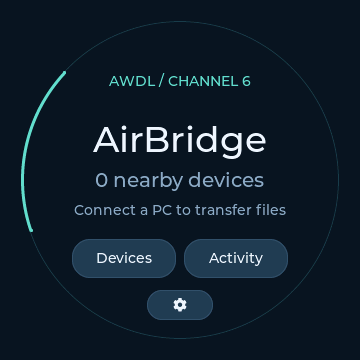

# AirBridge Round · Spotpear V1

An ESP-IDF **6.1** display variant on the **`round-display` branch**. `main` retains the standard ESP32-S3 firmware, Web Serial application, browser installer and Tauri client. This branch shares those host applications and the existing AWDL/AirDrop implementation; it adds a board-specific local interface, not a separate transfer protocol or a standalone file store.



*Captured from the running MCU framebuffer; physical display and touch were separately confirmed by the user.*

## Board and pins

Use the Spotpear ESP32-S3R8 **1.8-inch / 360×360 Round V1**, with **16 MiB flash and 8 MiB octal PSRAM**. Other circular displays or board revisions are not interchangeable. The local IDF 6.1 bring-up supplied the verified ST77916 and CST816S wiring. The driver code and required LVGL/cJSON sources are in this branch; no external `C:\b1_round_display_muse` directory is needed to build.

| Function | GPIO / configuration |
| --- | --- |
| ST77916 QSPI | SCK 9, CS 10, D0–D3 11/12/13/14, reset 47; SPI2, 40 MHz, RGB565 |
| Backlight | GPIO15, LEDC 5 kHz / 13 bit; default 65%, permitted 10–85% |
| CST816S touch | SDA7, SCL8, reset40, IRQ41; I2C0, address0x15, 400 kHz |
| BOOT button | GPIO0; short press returns home; hold during reset for ROM download |
| Host connection | Native USB Serial/JTAG, GPIO19/20; explicitly choose the board |

Audio, microphone, SD and wireless-power hardware are not initialized by this AirBridge variant. Files still pass through the PC. Their contents and permanent storage do not move to the screen, SD card or NVS. Existing non-overlapping flash data is not intentionally erased; the full board backup must be retained before replacing an existing application.

## Build

```powershell
# From the AirBridge repository, after checkout of round-display:
.\scripts\build-firmware.ps1 -BuildDirectory C:/abbuild/airbridge-round `
  -PublicBuild -PresenceTx -Ipv6Link -NativeService -LegacyRate1M -RoundDisplay
```

The helper uses the installed ESP-IDF 6.1 toolchain. Use a separate build directory for this profile. Defaults apply to a fresh `sdkconfig`; the round profile reserves **12 KiB for the main task** and 8 KiB for the UI task. Existing build directories must be regenerated/reconfigured when changing board defaults. LVGL objects live in PSRAM; the 10-row RGB565 DMA buffer stays internal. Non-DMA allocations above 2 KiB prefer PSRAM; FreeRTOS stacks remain internal. The 32 KiB native server stack is reserved before radio initialization. Native service tasks start before the LCD to preserve contiguous internal RAM; UI state and render snapshots are also stored in PSRAM. PSRAM remains at 40 MHz, full RF calibration and the validated 1 Mbps raw rate are retained, and the existing NVS/PHY/application offsets are unchanged.

Equivalent activated-IDF command:

```sh
idf.py -C firmware -B "$PWD/work/round-build" -DIDF_TARGET=esp32s3 \
  -DSDKCONFIG="$PWD/work/round-build/sdkconfig" \
  "-DSDKCONFIG_DEFAULTS=$PWD/firmware/sdkconfig.defaults;$PWD/firmware/round/sdkconfig.defaults" \
  -DAIRBRIDGE_ROUND_DISPLAY=ON -DAIRBRIDGE_PUBLIC_BUILD=ON \
  -DAIRBRIDGE_PRESENCE_TX=ON -DAIRBRIDGE_IPV6_LINK=ON \
  -DAIRBRIDGE_NATIVE_SERVICE=ON -DAIRBRIDGE_RAW_RATE_1M=ON build
```

The command uses absolute configuration paths so it works from the repository root. `round-display.yml` builds the distinct profile with the same pinned IDF 6.1 container as standard CI.

## Flash and recovery

Close the browser/desktop bridge and all serial monitors first. No other application may own the port. Identify the intended board with `python -m serial.tools.list_ports -v`; do not assume a COM number identifies a physical board.

```powershell
python scripts/flash-round.py --build C:/abbuild/airbridge-round `
  --port COMx --serial AA:BB:CC:DD:EE:FF `
  --evidence work/private-round-backup
```

Before the first replacement, retain a private full-flash backup with `python -m esptool --chip esp32s3 --port YOUR_PORT read-flash 0 0x1000000 before-round.bin`. Do not publish that backup.

The helper verifies the explicit USB identity and complete round/public build profile, backs up NVS, writes three separate segments, reads the entire programmed range back and compares every segment byte-for-byte. It also checks that NVS was preserved. The evidence directory must be new and kept private; it may contain pairing or device identity material. No whole-chip erase, eFuse change or merged-image padding is used.

For the separately packaged artifact, verify `SHA256SUMS` and every `MANIFEST.json` record before programming. After holding BOOT and tapping RESET if necessary, write **only these three segments** with esptool:

```sh
python -m esptool --chip esp32s3 --port YOUR_PORT --baud 460800 write-flash \
  --flash-mode dio --flash-size 16MB --flash-freq 80m \
  0x0 bootloader/bootloader.bin 0x8000 partition_table/partition-table.bin \
  0x10000 airbridge_native.bin
```

This overwrites the previous application. A failed/partial install requires reinstalling; retain the full preflash backup. The standard browser installer remains pinned to standard v0.0.1, so reinstalling from that entry removes the round UI. The round artifact has a distinct component/name and must not replace published default release assets.

## On-screen controls

- **Home:** moving AWDL ring, actual fresh AirDrop service count, and recent valid USB-host activity. A nearby AWDL source without a current AirDrop advertisement is not presented as a ready recipient.
- **Devices:** two rows per page, previous/next navigation, observed hostname or a native resolved name, address and actual RSSI. Touch a row for its details. Selection is tied to the address, not a recycled list index; stale recipients are disabled.
- **Read name:** performs the existing TLS/native `/Discover` request. A host hint stays explicitly unverified until that succeeds. The compact CJK fallback includes common characters; unsupported glyphs may display a placeholder, with the MAC retained for identification.
- **Allow sender / Revoke access:** changes the same session peer authorization used by the host. A new host HELLO session clears authorization as in the standard public firmware. This is not verified Apple-account/contact authentication. Busy/receiving conflicts are refused.
- **Activity:** independent incoming/outgoing states and progress. 100% bytes alone is not completion; incoming success needs Windows's persisted-file commit plus the native response. An interrupted/unconfirmed operation does not become a successful receipt. Outgoing files are still selected/staged by the existing Windows/web host; cancel runs through the existing command owner.
- **Settings:** bounded backlight control, stored in the separate `airbridge_round` NVS namespace. BOOT returns home. Display/touch initialization failures remain explicit startup errors.

Use [AirBridge Web](https://w0x7ce.eu/AirBridge/) or the existing desktop client after flashing. Choose a receive directory and explicitly connect the native USB port. The AirDrop service name remains **AirBridge PC**; the screen is the local control surface for that PC bridge. Keep Apple AirDrop open and set to Everyone, and keep the receiving host open until final file verification completes.

## Diagnostics and automatic acceptance

```powershell
python scripts/round-display.py --port COMx --serial AA:BB:CC:DD:EE:FF status
python scripts/round-display.py --port COMx --serial AA:BB:CC:DD:EE:FF screen `
  --view home --output work/round-home.png
python scripts/round-display.py --port COMx --serial AA:BB:CC:DD:EE:FF stability `
  --cycles 20 --output work/round-stability.json
```

Only one tool owns USB at a time. `ROUND STATUS` reports actual radio state, touch polls/errors/coordinates, LCD DMA completions, heap, uptime, reset cause and stack low-water marks. `ROUND VIEW` requests navigation on the sole LVGL task, not from the serial task. `ROUND SCREEN` reads a bounded RGB565 framebuffer through offset-checked records; a PNG is written only after all 259,200 bytes and the final completion record arrive. **That is a live render-buffer capture, not a photo proving glass color, orientation, light output or physical touch.** Do not infer native AirDrop success from an animation, a driver callback, a screenshot or CI.

The host C++ policy tests exercise expiration, selection identity, authorization, independent duplex progress and receipt gating. Python tests exercise frame byte order, PNG checksums, corrupt/truncated/duplicate chunks and refusal to write incomplete screenshots. CI builds the standard profile and this round variant separately. Raw Flash/NVS backups and nearby peer logs stay ignored under `work/`.

See [round hardware verification](round-display-verification.md) for the measured state and remaining physical acceptance, and [third-party source provenance](../firmware/round/THIRD_PARTY.md) for the display dependencies.
